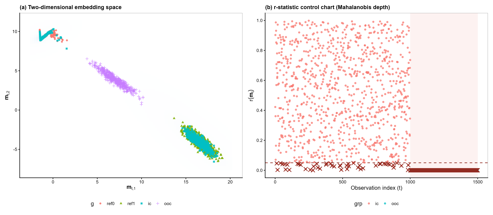

# Monitoring Neural Networks for Data Drift with Depth-Based Control Charts

R code and results for my BSc dissertation, *Statistical Process Monitoring of Artificial Neural Networks* (University of Glasgow, 2025–26), which received a first-class mark.

A deployed classifier keeps producing confident predictions even when the data it sees has quietly changed. True labels usually arrive late or not at all, so accuracy cannot be used to spot the change. This project monitors the network's internal representation instead: it takes the embeddings from the penultimate hidden layer, measures how typical each new embedding is compared with a reference set using statistical data depth, and plots the result on an r-statistic control chart that signals when new data stops resembling the training data.

It replicates and extends the framework of Malinovskaya, Mozharovskyi and Otto (2024), moving from a convolutional network on CIFAR to a feedforward network on MNIST, plus a controlled Gaussian simulation.



*Left: 2-D embeddings for the two reference classes, new in-control data, and drifted (out-of-control) data. Right: the control chart; points below the dashed line at α = 0.05 are signals. The shaded region is the drifted data, which is flagged almost entirely.*

## Experiments

**Toy Gaussian simulation** (`R/toy_example.R`). A 4 → 3 → 2 → 1 network on two Gaussian classes, giving 2-D embeddings. Drift is introduced by shifting the class-0 mean towards class 1 in steps of δ = 0.1 up to 0.5. Four depth functions are compared: Mahalanobis (MD), halfspace (HD), projection (PD) and simplicial (SD).

**MNIST** (`R/mnist_fashion_monitoring.R`). A 784 → 256 → 64 → 16 → 10 network (test accuracy 97.7%), monitored through its 16-dimensional embeddings. Two kinds of drift: Gaussian pixel noise (σ = 0.1 to 0.4) and a dataset shift to Fashion-MNIST images. Exact halfspace and projection depth are infeasible in 16 dimensions, so random-direction approximations (HDr, PD3, PDa3) are used alongside MD. Reference sets of 2,000, 3,000 and 4,000 embeddings per class.

Performance measures: false-alarm rate on the reference data (FAR), signal rate on new in-control data (SR, split into misclassified and correctly classified images), and correct detection rate on drifted data (CDR).

## Main results

- **No single depth method wins.** Under the Fashion-MNIST shift, Mahalanobis depth detected 88.5% of drifted images on average across ten resamples (95% bootstrap CI 87.7–89.2%), against 71.5% for halfspace depth. Under Gaussian noise the ranking reversed, with halfspace depth strongest at every noise level.
- **Calibration has to be checked before comparing methods.** MD, PD3 and PDa3 held FAR at the nominal 0.05 for every reference size. Approximate halfspace depth degenerated at 2,000 and 3,000 and only reached FAR = 0.038 at 4,000.
- **Many in-control signals come from the classifier's own mistakes.** With MD and 4,000 reference points, 80% of misclassified test images were flagged, compared with 14% of correctly classified ones.
- **In the toy study**, MD and PD reached full detection by δ = 0.3. Simplicial depth failed and was dropped from the MNIST work.

Limitations: one trained network and one random seed per experiment, so variation from network initialisation is not measured.

Full tables are in `mnist_experiment_outputs/tables/` and `toy_simulation_outputs/tables/`.

## How to run

Requires R with a working TensorFlow back end for `keras3`.

```r
install.packages(c("keras3", "tensorflow", "ddalpha", "dplyr", "tibble",
                   "tidyr", "ggplot2", "patchwork", "readr"))
keras3::install_keras()

# from the repository root
source("R/toy_example.R")               # writes to toy_simulation_outputs/
source("R/mnist_fashion_monitoring.R")  # writes to mnist_experiment_outputs/
source("R/generate_latex_tables.R")     # writes LaTeX tables to latex_tables/
```

Both experiment scripts cache the trained network and embeddings on the first run, so later runs skip training. Set `FAST_DEV <- TRUE` at the top of either script for a quick, smaller run.

## Reference

Malinovskaya, A., Mozharovskyi, P. and Otto, P. (2024). Statistical process monitoring of artificial neural networks. *Technometrics*, 66(1), 104–117. https://doi.org/10.1080/00401706.2023.2239886
