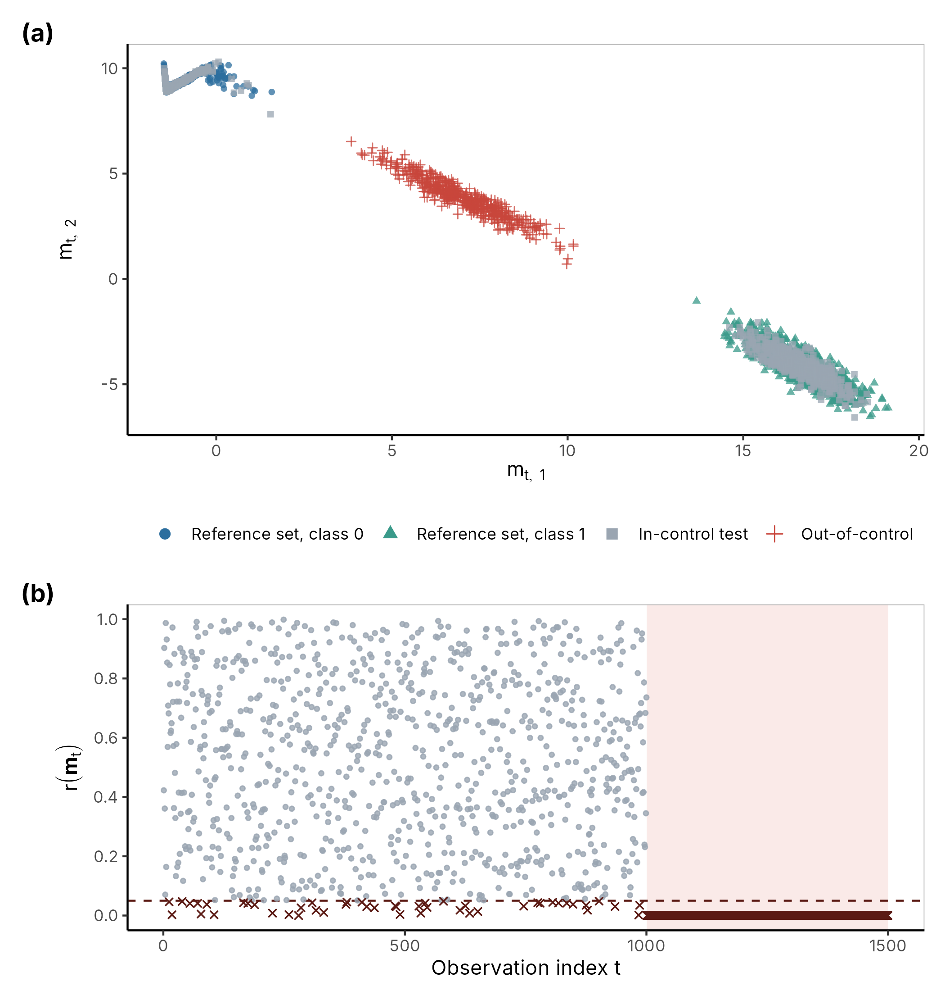

# Monitoring Neural Networks for Data Drift with Depth-Based Control Charts

R code and results for my BSc dissertation, *Statistical Process Monitoring of Artificial Neural Networks* (University of Glasgow, 2025–26), which received a first-class mark.

A deployed classifier keeps producing confident predictions even when the data it sees has quietly changed. True labels usually arrive late or not at all, so accuracy cannot be used to spot the change. This project monitors the network's internal representation instead. It takes the embeddings from the penultimate hidden layer and measures how typical each new embedding is compared with a reference set, using statistical data depth. It then plots the result on an r-statistic control chart, which signals when new data stops resembling the training data.

It replicates and extends the framework of Malinovskaya, Mozharovskyi and Otto (2024). Their image experiment used a convolutional network on CIFAR; this project uses a feedforward network on MNIST, plus a controlled Gaussian simulation.



*Toy simulation with Mahalanobis depth (2,000 reference points per class, strongest drift). (a) The 2-D embeddings: the two reference classes, new in-control data, and drifted (out-of-control) data, which lands between the classes. (b) The control chart. Points below the dashed line at α = 0.05 are signals. 48 of the 1,000 in-control points (4.8%) are flagged, in line with α, and all 500 drifted points in the shaded region are flagged.*

## Experiments

**Toy Gaussian simulation** (`R/toy_example.R`). A 4 → 3 → 2 → 1 network on two Gaussian classes gives 2-D embeddings. Drift comes from shifting the class-0 mean towards class 1 in steps of δ = 0.1, up to 0.5. Four depth functions are compared: Mahalanobis (MD), halfspace (HD), projection (PD) and simplicial (SD).

**MNIST** (`R/mnist_fashion_monitoring.R`). A 784 → 256 → 64 → 16 → 10 network (test accuracy 97.7%) is monitored through its 16-dimensional embeddings. There are two kinds of drift: Gaussian pixel noise (σ = 0.1 to 0.4) and a dataset shift to Fashion-MNIST images. Exact halfspace and projection depth are infeasible in 16 dimensions, so random-direction approximations (HDr, PD3, PDa3) are used alongside MD. Reference sets have 2,000, 3,000 or 4,000 embeddings per class.

There are three performance measures:
- **FAR:** the false-alarm rate on the reference data.
- **SR:** the signal rate on new in-control data, split into misclassified and correctly classified images.
- **CDR:** the correct detection rate on drifted data.

## Main results

- **No single depth method wins.** Under the Fashion-MNIST shift, Mahalanobis depth detected 88.5% of drifted images on average across ten resamples (95% bootstrap CI 87.7–89.2%), against 71.5% for halfspace depth. Under Gaussian noise the ranking reversed, with halfspace depth strongest at every noise level. Halfspace depth also had the highest signal rate on clean data, so part of that lead may come from a higher baseline rate of signals.
- **Calibration has to be checked before comparing methods.** MD, PD3 and PDa3 held FAR at the nominal 0.05 for every reference size. Approximate halfspace depth gave FAR of 0.000 and 0.005 at 2,000 and 3,000 reference points, so it was excluded there. It only reached 0.038 at 4,000.
- **Calibration on the reference set did not carry over fully to new data.** With MD and 4,000 reference points, 15% of clean test images were flagged, three times α. Images the classifier got wrong were far more likely to be flagged (80%, against 14% of correctly classified ones), but they are only about 2% of the test set, so most of those signals still come from correctly classified images.
- **Reference-set size is a trade-off.** Larger reference sets brought the in-control signal rate closer to α but made mild drift harder to detect.
- **In the toy study**, MD and PD reached full detection by δ = 0.3 and HD by δ = 0.4. Simplicial depth failed to detect the shift and was dropped from the MNIST work.

Limitations: one trained network and one random seed per experiment, so variation from network initialisation is not measured.

## Repository contents

```
R/toy_example.R                 Toy simulation: data, network, depth monitoring, sensitivity analysis
R/mnist_fashion_monitoring.R    MNIST experiment: Gaussian noise and Fashion-MNIST drift
R/toy_figure_pipeline.R         Redraws the figure above from the toy cache
R/generate_latex_tables.R       Turns the result CSVs into LaTeX tables
toy_simulation_outputs/         Toy results: CSV and text tables, figures
mnist_experiment_outputs/       MNIST results: CSV and text tables
latex_tables/                   Result tables formatted for LaTeX
figures/                        Figure used in this README
toy_cache_….rds, ….keras        Trained toy network and embeddings from the original run
```

Full results tables are in `toy_simulation_outputs/tables/` and `mnist_experiment_outputs/tables/`. The written report itself is not included here; it is available on request.

## How to run

Requires R with a working TensorFlow back end for `keras3`.

```r
install.packages(c("keras3", "tensorflow", "ddalpha", "dplyr", "tibble",
                   "tidyr", "ggplot2", "patchwork", "readr"))
keras3::install_keras()

# from the repository root
source("R/toy_example.R")               # writes to toy_simulation_outputs/
source("R/toy_figure_pipeline.R")       # writes figures/toy_pipeline.png
source("R/mnist_fashion_monitoring.R")  # writes to mnist_experiment_outputs/
source("R/generate_latex_tables.R")     # writes LaTeX tables to latex_tables/
```

Both experiment scripts cache the trained network and embeddings on the first run, so later runs skip training. Set `FAST_DEV <- TRUE` at the top of either script for a quick, smaller run.

### Reproducing the results

- **Toy simulation:** the cache from the original run is included (`toy_cache_….rds` and its two `.keras` files, about 0.6 MB). `R/toy_example.R` therefore loads the trained network instead of retraining, and should reproduce the toy tables here. It still needs TensorFlow installed, because it uses the saved network to score new resamples. `R/toy_figure_pipeline.R` needs only R.
- **MNIST:** the cache is not included (about 31 MB, as it holds the MNIST images), so `R/mnist_fashion_monitoring.R` downloads the data and retrains the network on its first run. Random seeds are fixed. Even so, neural-network training can differ slightly between machines and TensorFlow versions, so rerun MNIST results may differ slightly from the tables here. The conclusions should not change.

## Reference

Malinovskaya, A., Mozharovskyi, P. and Otto, P. (2024). Statistical process monitoring of artificial neural networks. *Technometrics*, 66(1), 104–117. https://doi.org/10.1080/00401706.2023.2239886
